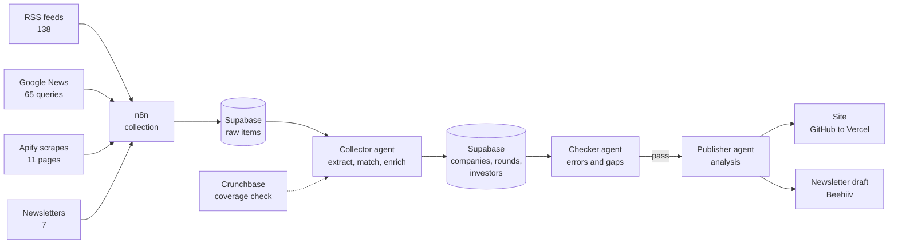

# What Got Funded

**[whatgotfunded.com](https://whatgotfunded.com)** · Weekly global startup-funding intelligence, built from a curated registry of public news sources.

Every week we collect the startup funding rounds announced across 343 news sources and 65 local-language news searches in 74 markets, turn them into structured records, and publish the week's rounds, totals and analysis on the site and in a Sunday newsletter.

This repository documents exactly where the data comes from and how it is processed. The full source registry is in [`sources/`](sources/), and the method is in [`docs/`](docs/).

> **Status (October 2026):** the source registry is built and every feed was tested on 11 October 2026. The collection pipeline, database and site described below are being built in this repository.

---

## What the product publishes

| Section | What it contains |
|---|---|
| What got funded last week | Every round announced in the week (Saturday to Friday): company, amount, stage, investors, sector, market, with a link to the original announcement |
| Totals | Capital and deal counts by market, region, stage and sector, ranked from highest to lowest |
| New rounds | New seed, Series A, B and C rounds called out separately |
| Deal flow | How deal volume and investor focus are shifting week on week |
| AI research | Trending papers, models, datasets and Spaces on Hugging Face |

Planned later: hiring signals from funded startups' job boards, partnership signals, and trend projections and quarterly reports once six months of weekly history exist.

## How the data is collected

The data comes from public sources: news outlets, press-release wires and company announcements. Commercial databases are used only to check that nothing was missed, never as a source of published data.

**Rule: every round we publish links to a public source** (a news article, a press release or the company's own announcement). A round found only in a commercial database is not published until a public source is found for it.

Data reaches the pipeline through four channels:

| Channel | Count | How it works |
|---|---|---|
| **RSS feeds** | 138 site feeds | Funding-category or site-wide feeds from startup and business news outlets, polled weekly by n8n. Site-wide feeds are filtered for funding stories. |
| **Google News searches** | 65 queries | Local-language funding searches (for example `資金調達 シリーズ`, `투자 유치 시리즈`, `Startup Finanzierungsrunde`, `startup ronda de inversión`) run as Google News RSS feeds limited to the past 7 days. They catch rounds in markets where outlets have no usable feed. |
| **Scraped pages** | 11 pages | Funding pages with no RSS feed, fetched weekly with Apify's `apify/web-fetch` actor. In testing, 5 returned clean dated funding lists, 3 need extra steps, 2 need a better URL retested and 1 is broken. Results for each page are in [`sources/scraped-pages.csv`](sources/scraped-pages.csv). |
| **Email newsletters** | 7 newsletters | Deal newsletters that publish lists not available by RSS (Axios Pro Rata, Fortune Term Sheet, CTVC, LAVCA, DealStreetAsia, Overnight Success, UKTN), received in a dedicated inbox and parsed by n8n. |

Two more inputs are used internally and never published as-is:

- **Coverage benchmarks.** Crunchbase (through its MCP connector) and Dealroom News act as weekly lead lists and a coverage check. We report the share of their rounds that our sources caught, and the rounds we found that they did not have. Regional quarterly reports (Cut Through Venture, Beauhurst, CVCA, MAGNiTT and others) are used to sanity-check totals. See [`sources/benchmarks.csv`](sources/benchmarks.csv).
- **Enrichment.** Company websites, Apollo and Clay fill in headcount, HQ and firmographics, and the company's own site and announcement supply its social profile links.

## Source coverage

| Region | Markets | Sources | Feeds ingested | Pages scraped |
|---|---|---|---|---|
| Asia-Pacific | 15 | 97 | 58 | 4 |
| Europe | 27 | 96 | 61 | 3 |
| Americas | 9 | 67 | 8 | 0 |
| Africa | 17 | 53 | 5 | 2 |
| Middle East | 5 | 28 | 4 | 2 |
| Global | 1 | 2 | 2 | 0 |
| **Total** | **74** | **343** | **138** | **11** |

"Markets" includes regional groupings such as Pan-APAC and Pan-Europe. Sources not ingested by feed or scrape are kept in the registry because they are used for manual checks or are candidates for future scraping; the reason for each is in its `notes` column.

Europe and Asia-Pacific are mostly automatable through RSS. The Americas, Africa and the Middle East rely more on Google News, newsletters and scraping, because many outlets there have no feed or block automated access.

## Weekly pipeline



| When (Sydney time) | Step |
|---|---|
| Saturday | n8n polls all feeds, runs the Apify scrapes and parses the newsletters for the week (Saturday to Friday), and writes raw items to Supabase |
| Saturday | **Collector agent** extracts structured rounds from the raw items, matches companies and investors to existing records, fills gaps, and checks coverage against Crunchbase |
| Saturday | **Checker agent** independently checks for failed feeds, empty scrapes, duplicates, missing source links and implausible amounts. Publishing is blocked if the checks fail. |
| Saturday night | **Publisher agent** computes the week's totals and analysis, commits the update to this repository (Vercel deploys it) and drafts the newsletter |
| Sunday | Newsletter is reviewed and sent |

## What each round record contains

| Field | Source |
|---|---|
| Company, domain, HQ, description of the product | Announcement and company website |
| Founders | Announcement and company website (names and public profile links only) |
| Amount, currency, stage, date | Announcement |
| Investors (lead and participating) | Announcement |
| Sector, market, region | Classified by the collector agent |
| Company and founder social profiles | Links found on the company website or in the announcement |
| Source URLs | Every source the round was found in, with the date |

The full data model is in [`docs/data-model.md`](docs/data-model.md), and the extraction, matching and checking rules are in [`docs/methodology.md`](docs/methodology.md).

## Collection rules

- **Public sources only for published data.** Commercial databases (Crunchbase, Dealroom, and later Tracxn) are used for discovery and checking, not republished.
- **Respect site rules.** Pages are only added to the scrape list if their `robots.txt` and terms allow it. Paywalled content is not scraped. Feeds whose terms forbid automated or AI processing are excluded (for example E24 in Norway).
- **Attribution.** Every round links to its source. Sources that require attribution and a link back (for example Globes) are credited.
- **LinkedIn is not scraped.** Founder and company LinkedIn profiles are stored as links only.
- **Personal data is minimal.** Founders are recorded by name, role and public professional profile links. No personal contact details are collected or published.

## Stack

| Tool | Role |
|---|---|
| GitHub | All code, source registry, agent definitions and n8n workflow exports |
| n8n | Scheduling and wiring: feed polling, Apify triggers, newsletter parsing, hand-offs between steps |
| Apify | Scraping pages that have no feed |
| Supabase | Database: companies, rounds, investors, founders, sources and weekly history |
| Claude Code | The collector, checker and publisher agents |
| Crunchbase MCP | Internal coverage check and gap-filling |
| Apollo, Clay | Company enrichment |
| Vercel | Hosting and deployment of whatgotfunded.com |
| Beehiiv | Newsletter |

## Repository layout

```
README.md                    This file
docs/
  methodology.md             How rounds are extracted, matched, checked and published
  data-model.md              Database tables and fields
sources/
  README.md                  Column definitions for every file in this folder
  sources.csv                All 343 sources with feed URLs, test status and collection method
  n8n-feeds.csv              The 203 feeds n8n polls (138 site feeds + 65 Google News queries)
  google-news-queries.csv    The 65 local-language Google News queries
  scraped-pages.csv          The 11 pages scraped with Apify and their test results
  newsletters.csv            The 7 deal newsletters parsed by email
  benchmarks.csv             Commercial databases and reports used for coverage checks
```

## Maintaining the source list

- **Adding a source:** add a row to `sources/sources.csv`, test its feed (or the page with Apify), record the result in `feed_status` and `last_verified`, and add the feed to `sources/n8n-feeds.csv` if it should be polled.
- **Health checks:** the checker agent flags feeds that return errors or no items for two consecutive weeks. Flagged sources are re-tested and either fixed, moved to scraping, or marked as not ingested with a reason.
- **Full re-verification:** every source is re-tested quarterly, and `last_verified` is updated.
